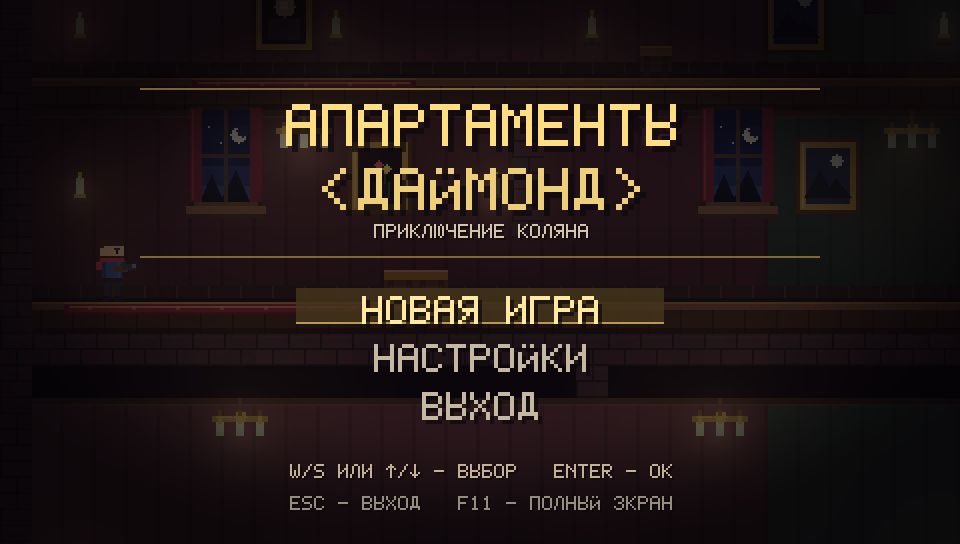
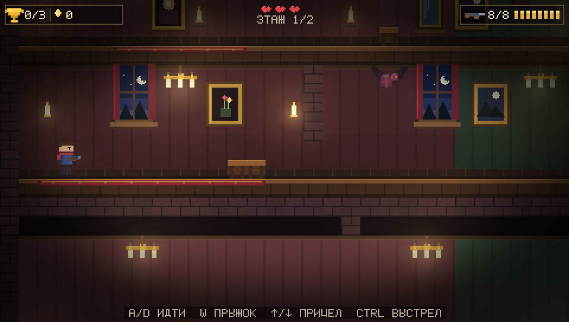
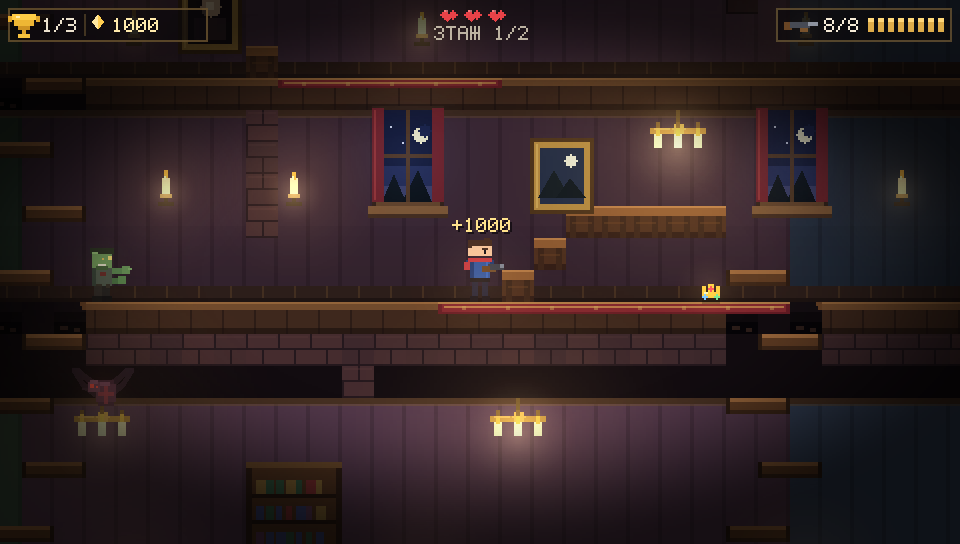
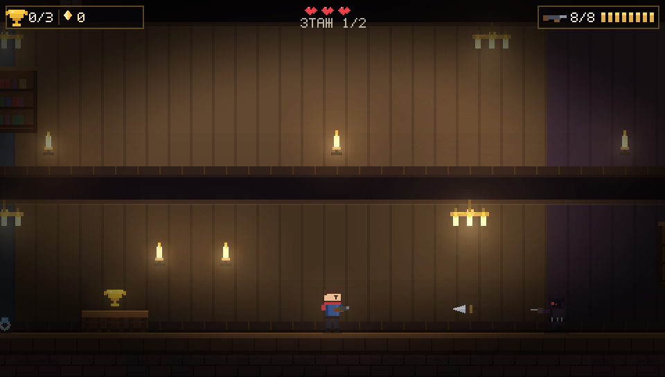
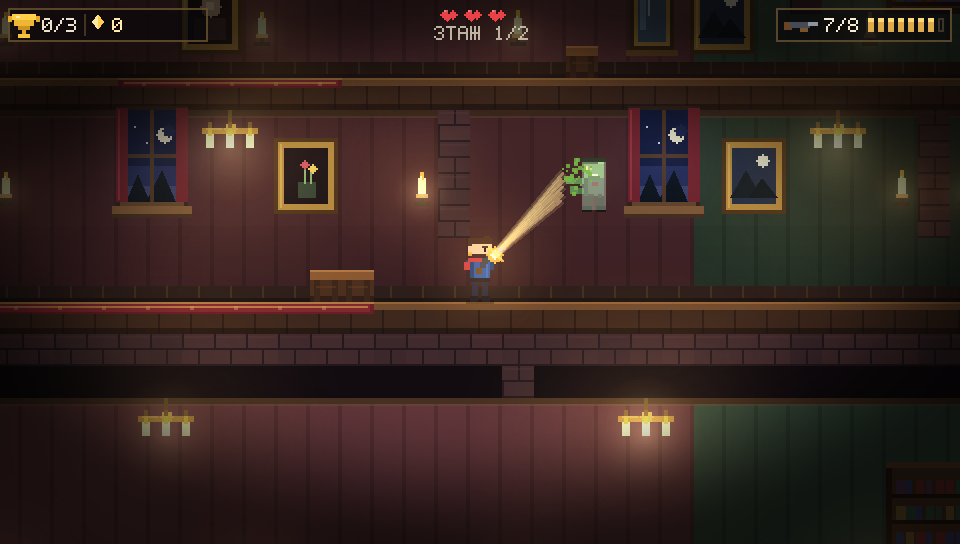
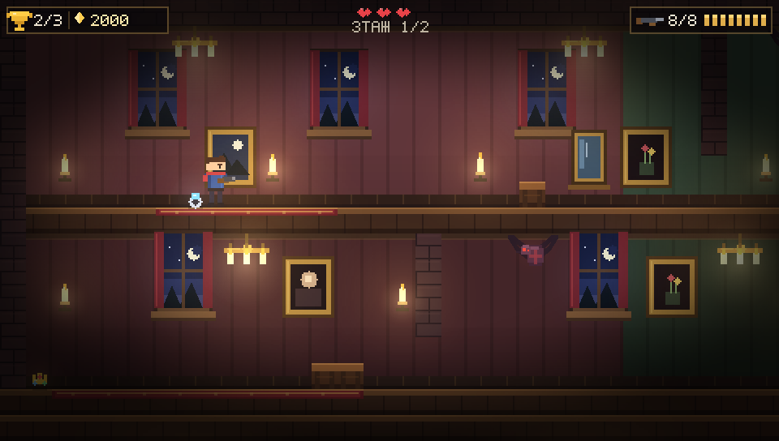
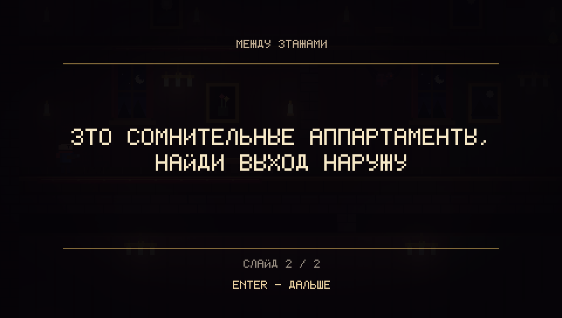
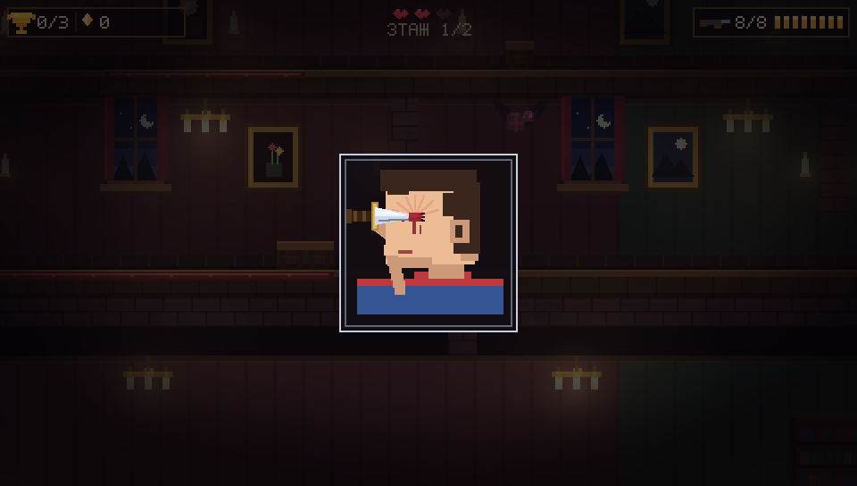
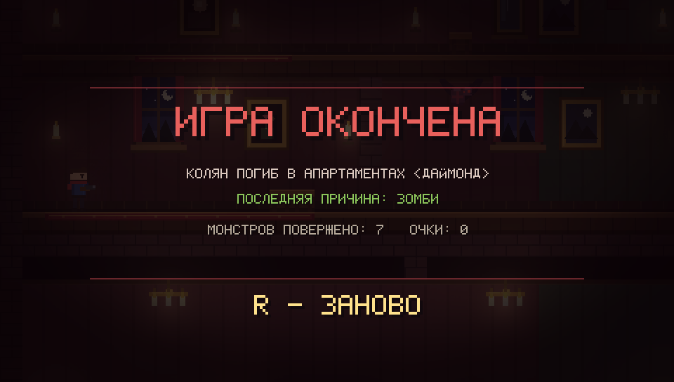
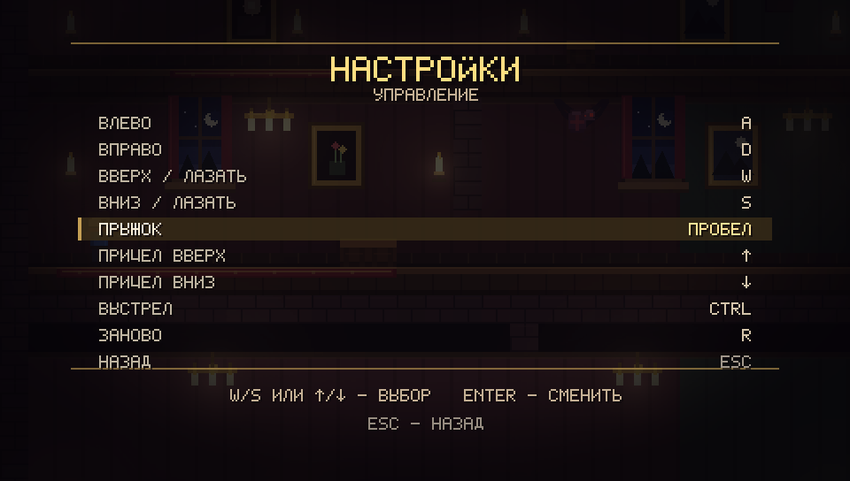

# Апартаменты «ДАЙМОНД» — приключение Коляна

Боевой двухуровневый 2D-скроллер в духе **Dangerous Dave**. Колян с дробовиком
пробивается через три этажа апартаментов «ДАЙМОНД» — подвал, первый и второй, —
собирает три кубка на каждом уровне, подбирает украшения, отстреливается от
монстров и уходит через парадную дверь.

C++17 + SDL2. Никаких картинок, шрифтов и звуков — вся графика рисуется кодом
(прямоугольники, треугольники и пиксельный шрифт 5x7).



## Что внутри

- **два уровня**: первый — 160 x 44 тайла, три этажа (второй, первый,
  подвал); второй — 160 x 34 тайла, два этажа. Этажи соединены лестницами.
  Подвал первого уровня укорочен вдвое — в нём меньше ступеней и ходу;
- **слайды между уровнями**: после двери первого этажа игра замирает на тёмной
  сцене с текстом. Первый переход — две реплики: «Колян. Лёха тебя кинул» и
  «это сомнительные аппартаменты, найди выход наружу». Листать — `Enter` или
  `Space`, `Esc` тоже перелистывает; после последнего слайда грузится следующий
  уровень. Для переходов без слайдов уровень загружается сразу;
- **Колян стал в полтора раза выше** (30 px вместо прежних 20) — фигура,
  дробовик и анимации перерисованы под новый рост;
- **вертикальная камера**: плавно едет за Коляном по всей высоте здания,
  а не только по горизонтали;
- **лестницы-зигзаги**: одна сквозная шахта идёт от подвала до второго этажа,
  остальные пролёты стоят в разных местах и соединяют соседние этажи. Ступени —
  платформы в два тайла из трёх, через каждые 32 px. На ступень нужно
  **запрыгивать** (`W` / `Space`), а чтобы спуститься — **шагнуть за край**:
  Колян падает на следующую нижнюю ступень, но сквозь неё не проваливается.
  Снизу ступень прозрачна, поэтому на неё можно заскочить с ходу;
- **главное меню**: «Новая игра», «Настройки», «Выход». Ходить по пунктам —
  `W`/`S` или `↑`/`↓`, выбрать — `Enter` или `Space`, выйти из игры можно
  пунктом «Выход» (или `Esc` в главном меню);
- **настройки управления**: у каждого действия **две клавиши** — основная и
  запасная. В меню выберите строку (`W`/`S` или `↑`/`↓`), нужную колонку
  (`A`/`D` или `←`/`→`), нажмите `Enter` и затем клавишу. `Esc` отменяет
  захват. Раскладка сохраняется в `kolek.cfg` рядом с игрой и загружается при
  запуске;
- **прицел следует за направлением движения**: вверх — `W` или `↑`, вниз —
  `S` или `↓`, по горизонтали — в сторону движения `A`/`D`. На лестнице эти же
  клавиши означают лазание;
- **три вида монстров**:
  - паук — живёт на потолке: ползёт по перекрытию своей комнаты, а оказавшись
    над Коляном, спускается к нему на паутине, висит и возвращается наверх.
    Стал выше в полтора раза, перебирает восемью лапами (3 HP);
  - зомби — высокий, медленный, в рваном пиджаке; тянет руки вперёд,
    патрулирует и преследует, стоит на полу своей клетки (4 HP);
  - **метатель ножей** — новый обитатель подвала: тёмный плащ, капюшон,
    пояс с ножами. Стоит и целится, когда Колян на одной с ним высоте,
    и бросает **медленный нож** (69 px/s, на треть быстрее прежнего — Колян
    всё ещё вдвое быстрее), который
    летит по прямой, пока не врежется в стену (3 HP);
- **очки**: зомби даёт 100, паук — 200, метатель ножей — 300, кубок — 1000,
  украшения — 200, 400 и 600. При каждом начислении над головой Коляна
  на секунду всплывает и тает надпись «+1000» (или другое число);
  счёт виден в HUD и на экранах победы/поражения;
- **три вида украшений** — серебряный перстень (200), золотой кулон с изумрудом
  (400) и корона с рубином (600). Они лежат на полу в случайных местах, по три
  каждого вида; каждый новый забег раскладывает их заново;
- **дробовик**: 8 патронов в магазине, 7 дробинок, **мгновенное попадание**
  (hitscan), веер разброса до ±6°, **дальность 640 px — на всю длину экрана**,
  угасающие трассеры, отдача, вспышка, вылет гильзы и тряска экрана.
  Горизонтальный выстрел **толкает Коляна назад**; стрелять можно только стоя
  на полу — **в прыжке дробовик молчит**;
- **диагональный прицел**: стрелки `↑` / `↓` поворачивают дробовик на 45°
  вперёд-вверх или вперёд-вниз с учётом направления взгляда; выстрел и искры
  уходят по этой же диагонали, но отдача при таком прицеле не толкает Коляна;
- **автоперезарядка**: Колян должен простоять неподвижно **не меньше 1 с**,
  после чего начинает перезаряжаться; полный магазин (8 патронов) заряжается
  ровно 2 с, а время пропорционально недостающим патронам (не хватает 6 — 1.5 с,
  не хватает 4 — 1 с, то есть 0.25 с за патрон).
  Пока идёт перезарядка, Колян не может двигаться и прыгать;
- **три жизни и чекпоинты на кубках**: касание монстра, нож или укус убивают
  сразу. После короткой анимации смерти Колян возрождается у **последнего
  взятого кубка**, а если на уровне ещё не взято ни одного кубка — на старте
  уровня; когда жизни кончаются — экран поражения;
- **двойной прыжок**: каждое нажатие прыжка в воздухе даёт один толчок,
  всего не больше двух прыжков подряд; после приземления счётчик сбрасывается;
- **три разные анимации смерти** в рамке, без единой надписи внутри:
  паук спускается на нити и кусает Коляна; зомби сзади сносит ему голову —
  голова отлетает, из шеи хлещет кровь; крупный нож влетает Коляну **в глаз**
  (вид строго в профиль) и застревает в переносице — с брызгами и струйкой
  крови;
- ступени-зигзаги, колонны, мебель-ступеньки, проёмы между этажами;
- три кубка на уровень, запертая парадная дверь, переход на второй этаж;
- слайды-сценки между уровнями с репликами Коляна;
- ковры, свечи, люстры, окна с луной, портреты (прорежены вдвое),
  зеркала и часы;
- камера с упреждением по скорости, тряска, частицы, виньетка и тёплые блики;
- **компактный HUD**: кубки и очки — в одной тонкой панели слева, крошечные
  сердца и номер этажа — сверху по центру, патроны с гильзами — справа;
- экран заголовка, экран смерти, экран поражения, экран победы и статистика
  по монстрам.

## Управление

Клавиши по умолчанию (каждое действие можно переназначить на две клавиши в
«Настройках»; `Esc` не переназначается):

| Действие | Клавиша 1 | Клавиша 2 |
|---|---|---|
| идти влево | `A` | `←` |
| идти вправо | `D` | `→` |
| вверх / лазать | `W` | `↑` |
| вниз / лазать | `S` | `↓` |
| прыжок | `Space` | `W` |
| выстрел | `Ctrl` | правый `Ctrl` |
| начать заново | `R` | — |

Прицел привязан к направлению движения: `W`/`↑` — вверх, `S`/`↓` — вниз,
`A`/`D` — влево/вправо. На лестнице эти же клавиши означают лазание.
Стрелять можно только стоя на полу; в прыжке дробовик молчит.

В главном меню: `W`/`S` или `↑`/`↓` — выбор, `Enter` или `Space` —
подтверждение. В «Настройках» `A`/`D` или `←`/`→` выбирают одну из двух
клавиш, `Enter` запускает переназначение, `Esc` возвращает назад.

`F11` в любом режиме включает и выключает полноэкранный режим (окно
растягивается на весь экран с сохранением пропорций картинки).

Соберите **3 кубка** на этаже, затем идите к парадной двери. Монстры убивают
с одного касания (нож — тоже): у Коляна три жизни, после смерти он возвращается
к последнему взятому кубку (или на старт уровня, если кубков ещё нет), кубки и
очки остаются при нём. Колян стартует на
первом этаже, дверь первого уровня находится в подвале; за ней — два слайда
(«Колян. Лёха тебя кинул», «это сомнительные аппартаменты, найди выход наружу»)
и второй уровень, после двери второго — победа.

## Сборка

### Windows (MSYS2 UCRT64) — проще всего

В терминале MSYS2 UCRT64:

```bash
pacman -S mingw-w64-ucrt-x86_64-gcc mingw-w64-ucrt-x86_64-SDL2
```

Затем в папке проекта (PowerShell или cmd):

```bat
build.bat
mansion.exe
```

`build.bat` использует `pkg-config` и кладёт `SDL2.dll` рядом с exe.

### CMake

```bash
cmake -S . -B build -G Ninja
cmake --build build
./build/mansion.exe
```

### Linux

```bash
sudo apt install build-essential libsdl2-dev
g++ -std=c++17 -O2 -Isrc src/main.cpp -o mansion $(pkg-config --cflags --libs sdl2)
./mansion
```

## Где что лежит

```
src/main.cpp   — вся игра: физика, монстры, дробовик, отрисовка, интерфейс
src/level.h    — две карты уровней (ASCII)
src/font.h     — пиксельный шрифт 5x7 и перенос текста
screenshots/   — скриншоты игры
kolek.cfg      — сохранённая раскладка клавиш (создаётся в игре)
CMakeLists.txt
build.bat
```

### Карта

`src/level.h` — две карты `LEVEL1_ROWS` (44 строки) и `LEVEL2_ROWS`
(34 строки), по 160 символов. Первый уровень — три этажа сверху вниз: второй,
первый и подвал (подвал вдвое ниже остальных этажей). Одна сквозная лестница
идёт от подвала до второго этажа,
остальные пролёты соединяют соседние этажи в разных местах. Второй уровень —
два этажа; через них проходят две такие же сквозные лестницы-зигзага из
двухтайловых ступеней. Колян стартует на первом этаже, а парадная дверь
находится в подвале:

| символ | значение |
|---|---|
| `#` | кирпичная стена |
| `=` | деревянный пол / перекрытие |
| `t` | мебель (твёрдая, можно запрыгнуть) |
| `S` | ступень лестницы (платформа: держит сверху, снизу прозрачна) |
| `K` | кубок |
| `D` | парадная дверь |
| `P` | старт игрока |
| `z` | паук (монстр) |
| `v` | зомби (монстр) |
| `n` | метатель ножей (монстр подвала) |
| `.` | пусто |

Можно смело править карты: ширина строк добивается автоматически, двери ищутся
по символам `D`, кубки — по `K`, монстры — по `z`, `v` и `n`. Зомби и метатель
ножей при спавне сами ищут пол под своей клеткой, пауки — потолок над ней.
Ступени `S` — one-way платформы: твёрдые только при падении сверху, поэтому
сквозь них нельзя провалиться. Чтобы добавить третий уровень, допишите массив
в `LEVEL_MAPS` в конце `src/level.h`.

## Служебные режимы

```bash
mansion.exe --smoke     # автопроверка: старт на 1-м этаже и дверь в подвале,
                        # бег, подъём по ступеням, ступень держит вес и не
                        # проваливается, падение на следующую ступень, паук
                        # ползёт по потолку и спускается на паутине, нож
                        # метателя, кубок, очки и всплывающие «+N», чекпоинт
                        # у последнего кубка, двойной
                        # прыжок, выстрел по зомби,
                        # диагональ вверх/вниз, пропорциональная перезарядка
                        # с блокировкой движения, смерть/жизни/поражение,
                        # переход на 2-й уровень: два слайда и загрузка этажа,
                        # подъём по его лестницам и победа,
                        # меню, вход в настройки, переназначение обеих клавиш,
                        # прицел по направлению движения и возврат в меню по Esc
mansion.exe --screens   # сохранить shot_*.bmp с разными сценами
```

Для скриншотов без окна:

```bash
set SDL_VIDEODRIVER=dummy
mansion.exe --screens
```

## Скриншоты

| | |
|---|---|
|  |  |
|  |  |
|  |  |
|  |  |
|  |  |
|  |  |
|  |  |
|  |  |
|  | |

## Идеи для продолжения

- четвёртый этаж и босс;
- больше типов монстров и оружия;
- звук через SDL_mixer;
- сохранение прогресса между запусками;
- редактор карт прямо в игре.
