# Апартаменты «ДАЙМОНД» — приключение Коляна

Боевой трёхуровневый 2D-скроллер в духе **Dangerous Dave**. Колян с дробовиком
пробивается через три уровня апартаментов «ДАЙМОНД» — особняк, технический
этаж и парадный вестибюль, — собирает три кубка на каждом уровне, подбирает
украшения, отстреливается от монстров и уходит через парадную дверь.

C++17 + SDL2. Никаких картинок, шрифтов и звуков — вся графика рисуется кодом
(прямоугольники, треугольники и пиксельный шрифт 5x7). Игра собирается под
Windows, Ubuntu/Linux и Android; на телефоне появляются экранные кнопки.


## Что внутри

- **три уровня**: первый — 160 x 44 тайла, три этажа (второй, первый,
  подвал); второй — 160 x 34 тайла, два этажа, оформленные как
  **технический этаж**: бетонные панели, кабельные лотки и аварийная
  разметка; третий — длинный **одноэтажный вестибюль** 240 x 22 тайла с
  мрамором, колоннами и ковровой дорожкой. Этажи первого и второго уровней
  соединены лестницами. Подвал первого уровня укорочен вдвое — в нём меньше
  ступеней и ходу;
- **слайды между уровнями**: после двери первого этажа игра замирает на тёмной
  сцене с текстом. Первый переход — две реплики: «Колян. Лёха тебя кинул» и
  «это сомнительные аппартаменты, найди выход наружу». Листать — `Enter` или
  `Space`, `Esc` тоже перелистывает; после последнего слайда грузится следующий
  уровень. Для переходов без слайдов уровень загружается сразу;
- **Колян стал в полтора раза выше** (30 px вместо прежних 20) — фигура,
  дробовик и анимации перерисованы под новый рост;
- **вертикальная камера**: плавно едет за Коляном по всей высоте здания,
  а не только по горизонтали;
- **лестницы-зигзаги**: одна сквозная шахта идёт от подвала до второго этажа,
  остальные пролёты стоят в разных местах и соединяют соседние этажи. Ступени —
  платформы в два тайла из трёх, через каждые 32 px. На ступень нужно
  **запрыгивать** (`W` / `Space`), а чтобы спуститься — **шагнуть за край**:
  Колян падает на следующую нижнюю ступень, но сквозь неё не проваливается.
  Снизу ступень прозрачна, поэтому на неё можно заскочить с ходу;
- **главное меню**: «Новая игра», «Настройки», «Выход». Ходить по пунктам —
  `W`/`S` или `↑`/`↓`, выбрать — `Enter` или `Space`. Закрыть игру можно
  **только пунктом «Выход»**; `Esc` в главном меню ничего не делает;
- **настройки управления**: у каждого действия **две клавиши** — основная и
  запасная. В меню выберите строку (`W`/`S` или `↑`/`↓`), нужную колонку
  (`A`/`D` или `←`/`→`), нажмите `Enter` и затем клавишу. `Esc` отменяет
  захват. Раскладка сохраняется в `kolek.cfg` рядом с игрой и загружается при
  запуске;
- **прицел следует за направлением движения**: вверх — `W` или `↑`, вниз —
  `S` или `↓`, по горизонтали — в сторону движения `A`/`D`. На лестнице эти же
  клавиши означают лазание;
- **четыре вида монстров**:
  - паук — живёт на потолке: ползёт по перекрытию своей комнаты, а оказавшись
    над Коляном, спускается к нему на паутине, висит и возвращается наверх.
    Стал выше в полтора раза, перебирает восемью лапами (3 HP);
  - **браток с битой** — высокий, в чёрной куртке и кепке, с золотой цепью;
    идёт на Коляна с занесённой битой. На 10% быстрее прежнего зомби:
    61.6 px/s в погоне и 22 px/s в патруле (4 HP);
  - **браток с пистолетом** — обитатель подвала в спортивных штанах; стоит и
    целится, когда Колян на одной с ним высоте, и стреляет **пулей**.
    Пуля летит на **20% быстрее прежнего ножа** (83 px/s), но всё равно
    **медленнее Коляна**, а сам стрелок патрулирует на **10% медленнее пули**
    (74.7 px/s), так что от него легко уйти (3 HP);
  - **доберман** — появляется на техническом этаже и в вестибюле: низкая
    длинная собака с **заниженным хитбоксом** (всего 14 px), красным ошейником
    и злым глазом. Быстро бросается на Коляна и кусает за ноги (2 HP);
- **очки**: браток с битой даёт 100, паук — 200, браток с пистолетом — 300,
  доберман — 250, кубок — 1000,
  украшения — 200, 400 и 600. При каждом начислении над головой Коляна
  на секунду всплывает и тает надпись «+1000» (или другое число);
  счёт виден в HUD и на экранах победы/поражения;
- **три вида украшений** — серебряный перстень (200), золотой кулон с изумрудом
  (400) и корона с рубином (600). Они лежат на полу в случайных местах, по три
  каждого вида; каждый новый забег раскладывает их заново. В вестибюле часть
  украшений лежит на высоких платформах — за ними надо прыгать;
- **дробовик**: 8 патронов в магазине, 7 дробинок, **мгновенное попадание**
  (hitscan), веер разброса до ±6°, **дальность 640 px — на всю длину экрана**,
  угасающие трассеры, отдача, вспышка, вылет гильзы и тряска экрана.
  Горизонтальный выстрел **толкает Коляна назад**; стрелять можно только стоя
  на полу — **в прыжке дробовик молчит**;
- **диагональный прицел**: стрелки `↑` / `↓` поворачивают дробовик на 30°
  вперёд-вверх или вперёд-вниз с учётом направления взгляда; выстрел и искры
  уходят по этой же диагонали, но отдача при таком прицеле не толкает Коляна;
- **автоперезарядка**: Колян должен простоять неподвижно **не меньше 1 с**,
  после чего начинает перезаряжаться; полный магазин (8 патронов) заряжается
  ровно 2 с, а время пропорционально недостающим патронам (не хватает 6 — 1.5 с,
  не хватает 4 — 1 с, то есть 0.25 с за патрон).
  Пока идёт перезарядка, Колян не может двигаться и прыгать;
- **три жизни и чекпоинты на кубках**: касание монстра, пуля или укус собаки
  убивают сразу. После короткой анимации смерти Колян возрождается у **последнего
  взятого кубка**, а если на уровне ещё не взято ни одного кубка — на старте
  уровня; когда жизни кончаются — экран поражения;
- **двойной прыжок**: каждое нажатие прыжка в воздухе даёт один толчок,
  всего не больше двух прыжков подряд; после приземления счётчик сбрасывается;
- **пять разных анимаций смерти** в рамке, без единой надписи внутри:
  паук спускается на нити и кусает Коляна; браток с битой сзади сносит ему
  голову — голова отлетает, из шеи хлещет кровь; пуля влетает Коляну **в глаз**
  (вид строго в профиль), застревает в переносице, а из затылка бьют красные
  брызги; доберман набрасывается и сбивает верхнюю часть Коляна, после чего
  внутренняя рамка кадра постепенно краснеет по частям; в вестибюле падение
  в пропасть — Колян кувыркается в тёмной шахте;
- ступени-зигзаги, колонны, мебель-ступеньки, проёмы между этажами;
- три кубка на уровень, запертая парадная дверь, переход на следующий этаж;
- **выход со второго уровня — грузовой лифт**: стальной портал, раздвижные
  створки, табло из трёх ламп (загораются по кубкам) и кнопка вызова.
  Когда все кубки собраны, створки разъезжаются и из шахты льётся тёплый
  свет;
- **третий уровень — длинный вестибюль**: мраморные стены с бронзовыми
  пилястрами, люстры, бра, портреты и зеркала; между залами зияют пропасти,
  которые перелетают по мраморным платформам. По таким же платформам можно
  забраться наверх за кубками и украшениями. В вестибюле дежурят братки с
  битами и доберманы, а у двери стоит один браток с пистолетом. Падение в
  пропасть отнимает жизнь;
- слайды-сценки между уровнями с репликами Коляна;
- убранство особняка: ковры, свечи, люстры, окна с луной, портреты
  (прорежены вдвое), зеркала и часы; на техническом этаже — мигающие
  аварийные лампы, стремянки, трубы с вентилями, вентиляционные решётки,
  электрощиты, таблички «ТЕХ» и мотки кабеля; в вестибюле — мрамор,
  дубовые панели, бронзовые пилястры и ковровая дорожка;
- камера с упреждением по скорости, тряска, частицы, виньетка и тёплые блики;
- **компактный HUD**: кубки и очки — в одной тонкой панели слева, крошечные
  сердца и номер этажа — сверху по центру, патроны с гильзами — справа;
- экран заголовка, экран смерти, экран поражения, экран победы и статистика
  по монстрам.

## Управление

Клавиши по умолчанию (каждое действие можно переназначить на две клавиши в
«Настройках»; `Esc` не переназначается):

| Действие | Клавиша 1 | Клавиша 2 |
|---|---|---|
| идти влево | `A` | `←` |
| идти вправо | `D` | `→` |
| вверх / лазать | `W` | `↑` |
| вниз / лазать | `S` | `↓` |
| прыжок | `Space` | `W` |
| выстрел | `Ctrl` | правый `Ctrl` |
| начать заново | `R` | — |

Прицел привязан к направлению движения: `W`/`↑` — вверх, `S`/`↓` — вниз,
`A`/`D` — влево/вправо. На лестнице эти же клавиши означают лазание.
Стрелять можно только стоя на полу; в прыжке дробовик молчит.

В главном меню: `W`/`S` или `↑`/`↓` — выбор, `Enter` или `Space` —
подтверждение. В «Настройках» `A`/`D` или `←`/`→` выбирают одну из двух
клавиш, `Enter` запускает переназначение, `Esc` возвращает назад.

В игре `Esc` возвращает в главное меню, но **не закрывает игру**: для выхода
нужно выбрать пункт «Выход». `F11` в любом режиме включает и выключает
полноэкранный режим (окно растягивается на весь экран с сохранением пропорций
картинки).

### DEV: секретная дверь

На стадии разработки работает чит **`Ctrl+R`**: рядом с Коляном появляется
светящаяся дверь, а вход в неё открывает экран выбора уровня. Повторный
`Ctrl+R` убирает дверь. На экране выбора `W`/`S` или `↑`/`↓` выбирают уровень,
`Enter` загружает его, `Esc` возвращает в игру. Чит включается константой
`DEV_SECRET_LEVELS` в `src/main.cpp`; перед релизом достаточно поставить
`false` (и убрать экран выбора).

### Android

На телефоне игра запускается в полноэкранном ландшафтном режиме, а поверх неё
рисуются полупрозрачные кнопки:

- слева крестовина — идти влево/вправо, лазать и прицеливаться вверх/вниз;
- справа `ПРЫЖОК` и `ОГОНЬ` (в меню эта же кнопка работает как `ОК`);
- сверху справа `МЕНЮ` — выход в главное меню; системная кнопка «Назад»
  на Android делает то же самое;
- в меню, настройках и слайдах крестовина и `ОК` листают пункты, а `МЕНЮ`
  возвращает назад; на экранах победы и поражения появляется `ЗАНОВО`.

Экранные кнопки не зависят от раскладки клавиатуры. Физическую клавиатуру
Android тоже поддерживает.

Соберите **3 кубка** на этаже, затем идите к парадной двери. Монстры убивают
с одного касания (пуля и укус собаки — тоже): у Коляна три жизни, после смерти он возвращается
к последнему взятому кубку (или на старт уровня, если кубков ещё нет), кубки и
очки остаются при нём. Колян стартует на
первом этаже, дверь первого уровня находится в подвале; за ней — два слайда
(«Колян. Лёха тебя кинул», «это сомнительные аппартаменты, найди выход наружу»)
и второй уровень. Дверь второго уровня — грузовой лифт, он ведёт в третий,
парадный вестибюль; после двери вестибюля — победа.

## Сборка

Нужны компилятор C++17 и SDL2 2.x. Для Android дополнительно требуются JDK 17,
Android SDK и NDK — подробности ниже.

### Windows — настольная версия

Проще всего собрать в MSYS2 UCRT64. Установите MSYS2, откройте терминал
**MSYS2 UCRT64** и выполните:

```bash
pacman -Syu
pacman -S mingw-w64-ucrt-x86_64-gcc mingw-w64-ucrt-x86_64-SDL2 \
          mingw-w64-ucrt-x86_64-cmake mingw-w64-ucrt-x86_64-ninja
```

Затем перейдите в папку проекта и запустите сборку:

```bash
cd /c/путь/к/kolek
./build.bat
./mansion.exe
```

`build.bat` использует `pkg-config`, компилирует `src/main.cpp` и кладёт
`SDL2.dll` рядом с `mansion.exe`. Если запускаете его из PowerShell или cmd,
добавьте в `PATH` каталог `C:\msys64\ucrt64\bin` (там лежат `g++.exe` и
`pkg-config.exe`) либо запускайте из терминала MSYS2 UCRT64.

То же самое через CMake:

```bat
cmake -S . -B build -G Ninja
cmake --build build
build\mansion.exe
```

### Ubuntu / Linux — настольная версия

```bash
sudo apt update
sudo apt install build-essential cmake ninja-build libsdl2-dev
cmake -S . -B build -G Ninja
cmake --build build
./build/mansion
```

Можно и одной командой без CMake:

```bash
g++ -std=c++17 -O2 -Isrc src/main.cpp -o mansion \
    $(pkg-config --cflags --libs sdl2)
./mansion
```

Полезные ключи: `./mansion --smoke` — автоматическая проверка игры,
`./mansion --touch` — посмотреть экранные кнопки на компьютере.

### Android

Android-проект лежит в каталоге `android/`. Он собирает и игру, и SDL2 из
исходников, поэтому отдельная SDL2 для телефона не нужна.

Что установить через SDK Manager в Android Studio (или `sdkmanager`):

- **SDK Platform 35** (Android 15);
- **NDK 26.1.10909125** (версия указана в `android/app/build.gradle`);
- **CMake 3.22.1** или новее;
- **JDK 17** (Android Studio ставит его вместе с собой).

#### Ubuntu — командная строка

Установите JDK и утилиты Android SDK:

```bash
sudo apt install openjdk-17-jdk unzip curl

# Скачайте command-line tools с developer.android.com, распакуйте в:
#   ~/Android/Sdk/cmdline-tools/latest
export ANDROID_HOME="$HOME/Android/Sdk"
export JAVA_HOME="/usr/lib/jvm/java-17-openjdk-amd64"
export PATH="$ANDROID_HOME/cmdline-tools/latest/bin:$ANDROID_HOME/platform-tools:$PATH"

yes | sdkmanager --licenses
sdkmanager "platform-tools" "platforms;android-35" \
           "build-tools;35.0.0" "ndk;26.1.10909125" "cmake;3.22.1"
```

Сборка и установка на подключённый по USB телефон (включена отладка по USB):

```bash
cd android
./gradlew assembleDebug
adb install -r app/build/outputs/apk/debug/app-debug.apk
```

Либо сразу `./gradlew installDebug` — Gradle сам найдёт устройство через adb.
APK после сборки: `android/app/build/outputs/apk/debug/app-debug.apk`.

#### Windows — Android Studio

1. Установите Android Studio.
2. В **SDK Manager → SDK Platforms** отметьте Android 15 (API 35), в
   **SDK Tools** — NDK 26.1.10909125 и CMake.
3. Откройте в Android Studio папку **`android`** (не корень проекта) и
   дождитесь синхронизации Gradle.
4. Подключите телефон с включённой отладкой по USB и нажмите **Run**, либо
   соберите APK: **Build → Build Bundle(s) / APK(s) → Build APK(s)**.

Через PowerShell без Android Studio (нужны установленные SDK/NDK/JDK 17):

```powershell
$env:ANDROID_HOME = "$env:LOCALAPPDATA\Android\Sdk"
$env:JAVA_HOME = "C:\Program Files\Android\Android Studio\jbr"
$env:Path = "$env:ANDROID_HOME\platform-tools;$env:Path"

cd android
.\gradlew.bat assembleDebug
adb install -r app\build\outputs\apk\debug\app-debug.apk
```

Если Gradle не видит SDK, создайте `android/local.properties`:

```properties
sdk.dir=C\:\\Users\\ИМЯ\\AppData\\Local\\Android\\Sdk
```

#### SDL2 для Android и сборка без сети

При первой сборке CMake сам скачивает SDL2 2.32.10 с GitHub. Если нужна
офлайн-сборка, скачайте SDL2 заранее:

```bash
# Ubuntu
./android/fetch-sdl2.sh
```

```powershell
# Windows
powershell -ExecutionPolicy Bypass -File android\fetch-sdl2.ps1
```

Скрипт положит исходники в `android/SDL2`, Gradle подхватит их автоматически.
Можно указать и произвольный путь:

```bash
./gradlew assembleDebug -PSDL2_DIR=/path/to/SDL2-2.32.10
```

Если установлена другая версия NDK, поменяйте `ndkVersion` в
`android/app/build.gradle`. Минимальная версия Android — 5.0 (API 21).

#### Выпуск APK

```bash
cd android
./gradlew assembleRelease
```

Готовый APK будет в `android/app/build/outputs/apk/release/`. Перед установкой
на телефон его нужно подписать (`apksigner` или Android Studio → **Generate
Signed Bundle / APK**). Для быстрой проверки на телефоне достаточно
`assembleDebug`/`installDebug`.

## Где что лежит

```
src/main.cpp   — вся игра: физика, монстры, дробовик, отрисовка, интерфейс
src/level.h    — три карты уровней (ASCII)
src/font.h     — пиксельный шрифт 5x7 и перенос текста
screenshots/   — скриншоты игры
kolek.cfg      — сохранённая раскладка клавиш (создаётся в игре)
CMakeLists.txt — общая сборка для Windows/Linux и Android (для Android — libmain.so)
build.bat      — быстрая сборка для Windows/MinGW
android/       — Gradle-проект Android-приложения
  app/         — манифест, ресурсы, Java-часть SDLActivity
  fetch-sdl2.sh / .ps1 — офлайн-загрузка исходников SDL2
```

### Карта

`src/level.h` — три карты: `LEVEL1_ROWS` (44 строки), `LEVEL2_ROWS`
(34 строки) и `LEVEL3_ROWS` (22 строки). Первые две — по 160 символов в
строке, вестибюль — 240. Первый уровень — три этажа сверху вниз: второй,
первый и подвал (подвал вдвое ниже остальных этажей). Одна сквозная лестница
идёт от подвала до второго этажа,
остальные пролёты соединяют соседние этажи в разных местах. Второй уровень —
технический этаж с двумя ярусами; через них проходят две такие же сквозные
лестницы-зигзага из двухтайловых ступеней. Колян стартует на первом этаже, а
парадная дверь находится в подвале; на втором уровне вместо неё — дверь
грузового лифта, а на третьем — дверь в конце вестибюля (тот же символ `D`).

Третий уровень — один длинный зал: пол на 16-м ряду, под ним тёмная шахта.
Четыре пропасти прорезают пол, через них ведут мраморные платформы `S`, а
такие же платформы-лестницы поднимаются к кубкам и украшениям наверху. Упасть
в пропасть — значит погибнуть (отдельная анимация смерти).

| символ | значение |
|---|---|
| `#` | стена (кирпич, бетон или мрамор — зависит от уровня) |
| `=` | пол / перекрытие |
| `t` | мебель (твёрдая, можно запрыгнуть) |
| `S` | ступень лестницы или мраморная платформа (держит сверху, снизу прозрачна) |
| `K` | кубок |
| `D` | парадная дверь, дверь лифта или выход из вестибюля |
| `P` | старт игрока |
| `z` | паук (монстр) |
| `v` | браток с битой (монстр) |
| `n` | браток с пистолетом (подвал и вестибюль) |
| `d` | доберман (второй и третий уровни) |
| `.` | пусто; на полу вестибюля — пропасть |

Можно смело править карты: ширина строк добивается автоматически, двери ищутся
по символам `D`, кубки — по `K`, монстры — по `z`, `v`, `n` и `d`. Братки,
доберманы и стрелки при спавне сами ищут пол под своей клеткой, пауки — потолок
над ней. Платформы `S` — one-way: твёрдые только при падении сверху, поэтому
сквозь них нельзя провалиться. Чтобы добавить четвёртый уровень, допишите
массив в `LEVEL_MAPS` в конце `src/level.h` и увеличьте `LEVEL_COUNT`.

## Служебные режимы

```bash
mansion.exe --smoke     # автопроверка: старт на 1-м этаже и дверь в подвале,
                        # бег, подъём по ступеням, ступень держит вес и не
                        # проваливается, падение на следующую ступень, паук
                        # ползёт по потолку и спускается на паутине, пуля
                        # братка с пистолетом (скорость, выстрел, смерть),
                        # скорость патруля стрелка, доберман на карте,
                        # заниженный хитбокс и укус, кубок, очки и «+N»,
                        # чекпоинт у последнего кубка, двойной
                        # прыжок, выстрел по братку с битой,
                        # диагональ вверх/вниз, пропорциональная перезарядка
                        # с блокировкой движения, смерть/жизни/поражение,
                        # переход на 2-й уровень: два слайда и загрузка этажа,
                        # подъём по его лестницам, фон и фурнитура
                        # технического этажа (лампы, стремянки), выход в
                        # вестибюль: одноэтажный зал, платформы, пропасти,
                        # братки, доберманы и один стрелок у двери,
                        # кубки и украшения наверху, смерть при падении
                        # в пропасть и возврат на чекпоинт, победа,
                        # меню, вход в настройки, переназначение обеих клавиш,
                        # прицел по направлению движения и возврат в меню по Esc
mansion.exe --screens   # сохранить shot_*.bmp с разными сценами
```

Для скриншотов без окна:

```bash
set SDL_VIDEODRIVER=dummy
mansion.exe --screens
```

## Скриншоты

| | |
|---|---|
|  |  |
|  | 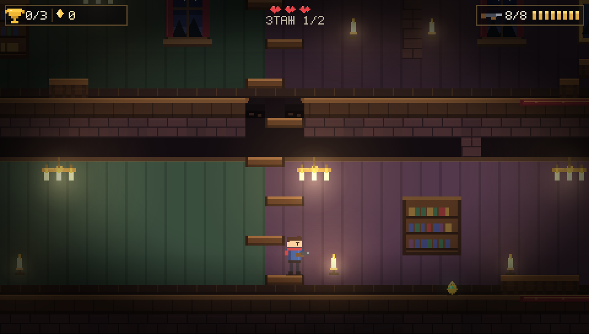 |
|  |  |
| 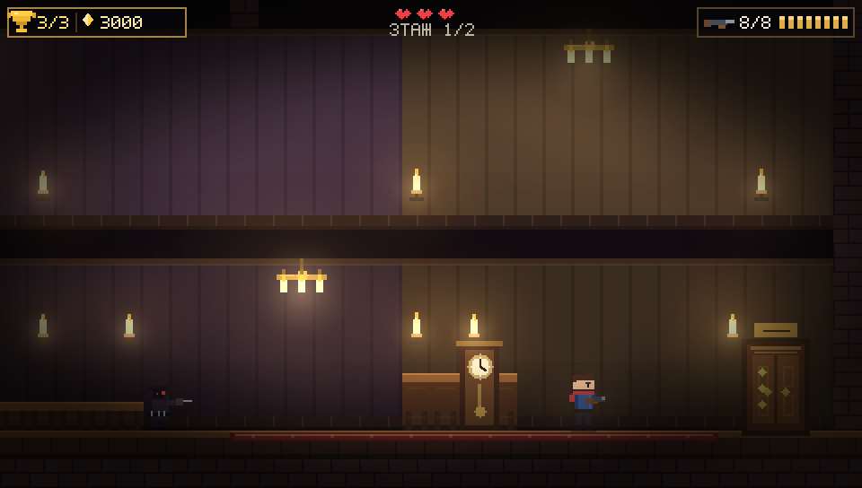 | 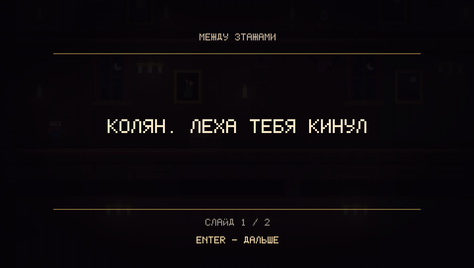 |
|  | 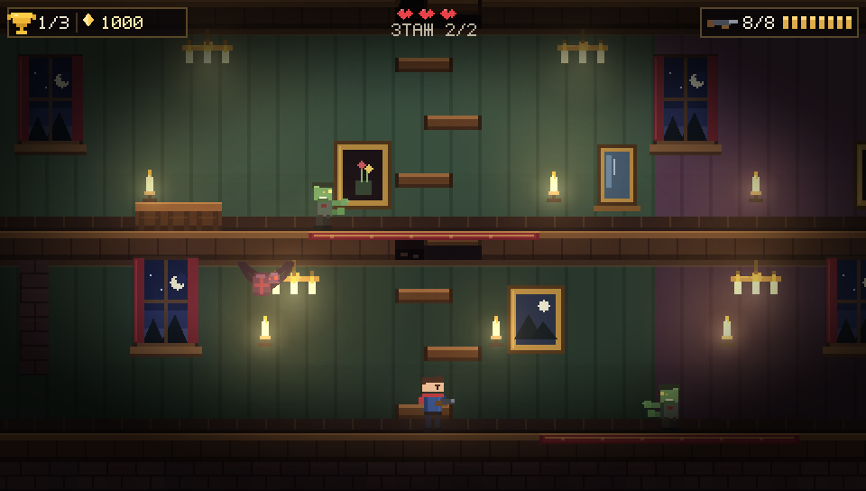 |
| 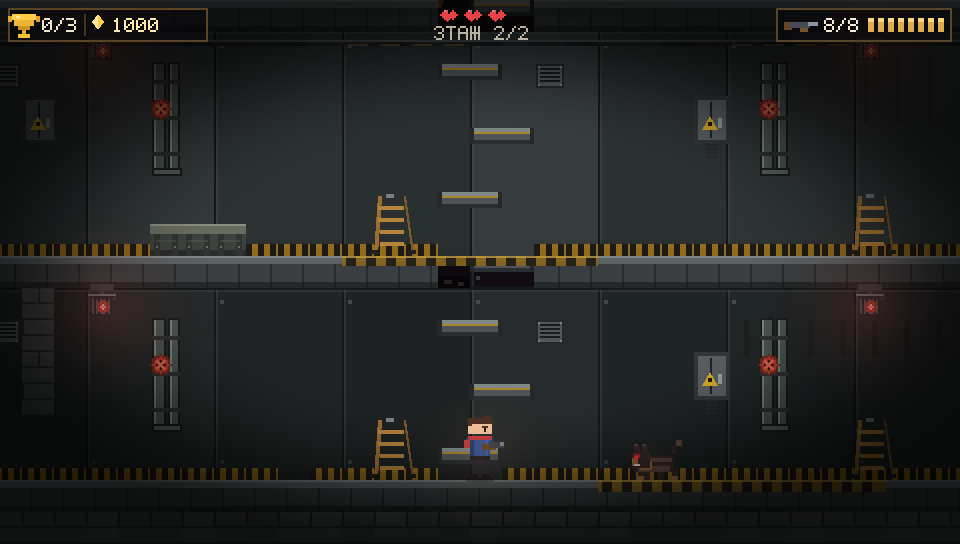 | 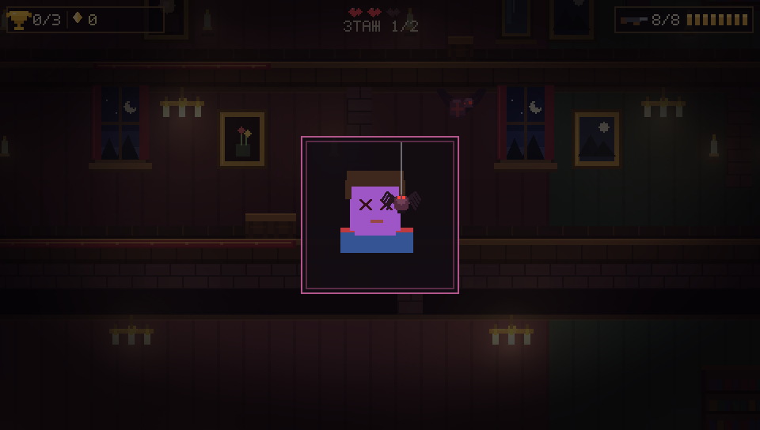 |
| 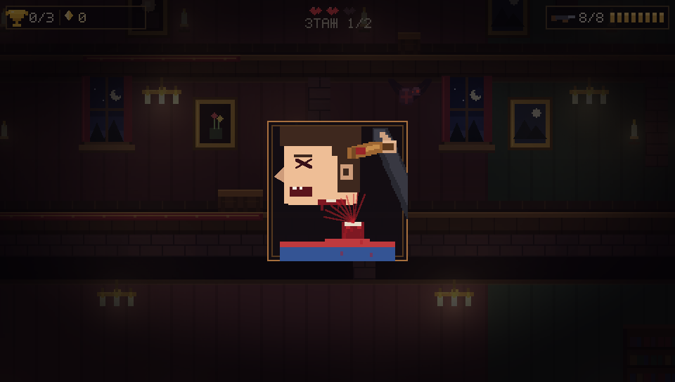 | 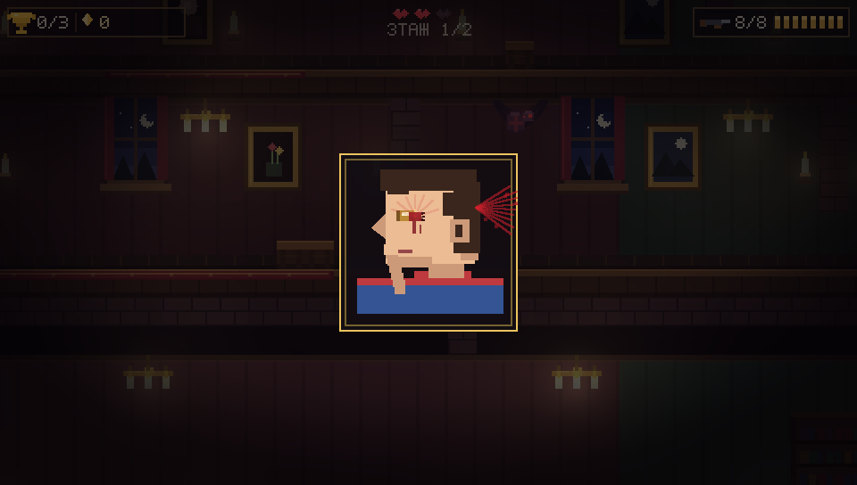 |
| 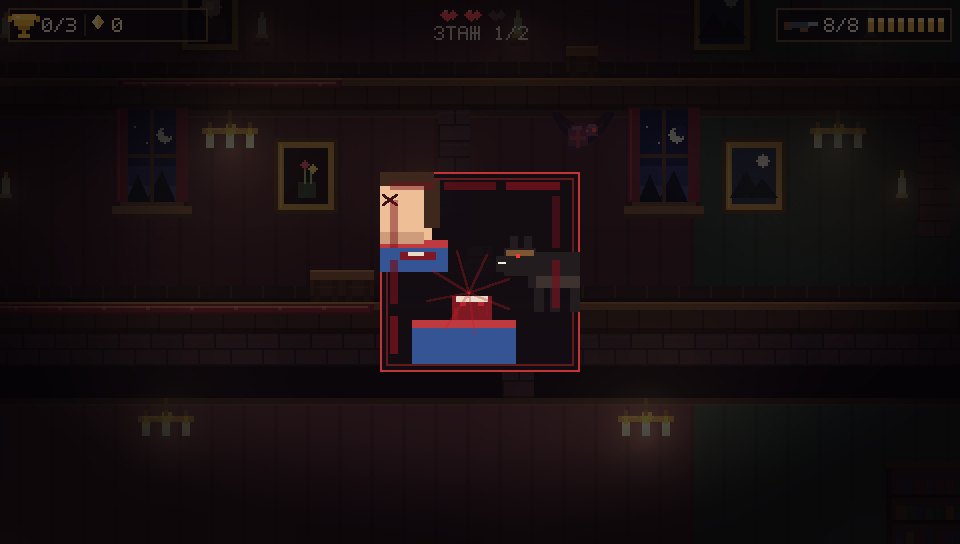 |  |
| 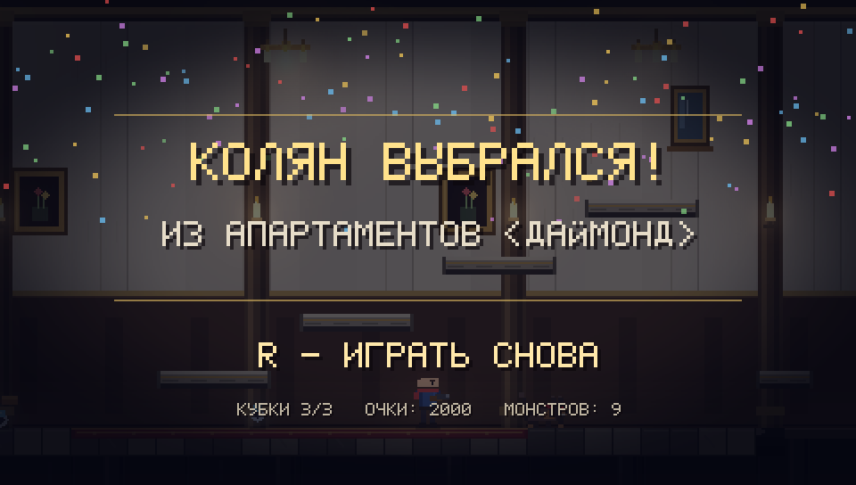 | 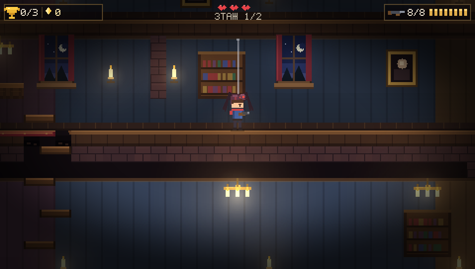 |
|  | 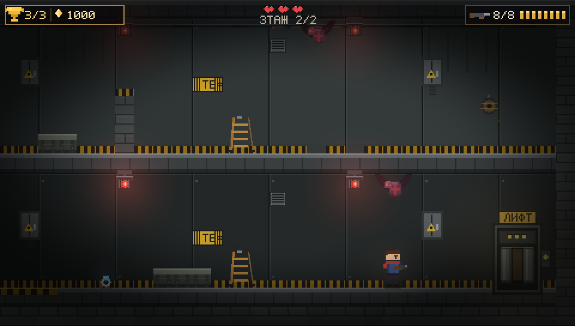 |
| 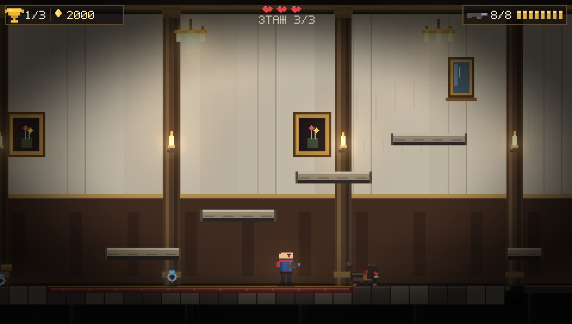 | 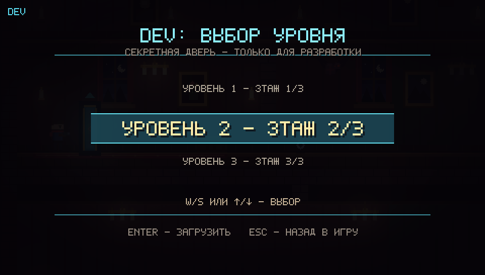 |

## Идеи для продолжения

- четвёртый этаж и босс;
- больше типов монстров и оружия;
- звук через SDL_mixer;
- сохранение прогресса между запусками;
- редактор карт прямо в игре.
